# TruckIDMe

**Open-set driver identification from heavy-duty J1939 CAN data.** Given a few
minutes of a truck's CAN traffic, identify which of a fleet's known drivers is at
the wheel — and recognise when it is nobody the system has enrolled.

Data: the ORNL Driver Identification Dataset (50 participants, 2014 Kenworth T270
Class 6, Fort Collins CO; 46 drivers usable). Built on prior work presented as
*TruckIDMe: Driver Identification from J1939 CAN Bus Signals*, IEEE AIMS 2025.

- **Methodology and settled decisions:** [`PIPELINE.md`](PIPELINE.md)
- **Capstone proposal:** [`outputs/reports/capstone_proposal.md`](outputs/reports/capstone_proposal.md)
- **How provenance works:** [`PROVENANCE.md`](PROVENANCE.md)

<!-- PIPELINE:START -->

## Pipeline overview

_Auto-generated by `python -m src.pipeline graph` — do not edit by hand._

```mermaid
flowchart LR
  subgraph n_data["Data preparation"]
    n_build_processed_data["build_processed_data"]
    n_build_sector_map["build_sector_map"]
    n_assign_sectors["assign_sectors"]
    n_build_master_timeline["build_master_timeline"]
  end
  subgraph n_features["Feature engineering"]
    n_build_feature_matrix["build_feature_matrix"]
    n_build_windowed_feature_matrix["build_windowed_feature_matrix"]
  end
  subgraph n_models["Baseline models"]
    n_build_baseline_classifier["build_baseline_classifier"]
    n_run_window_sweep_chrono["run_window_sweep_chrono"]
    n_build_pertick_baseline["build_pertick_baseline"]
  end
  subgraph n_tsfm["Foundation-model track (planned)"]
    n_build_windows["build_windows"]
    n_embed_mantis["embed_mantis"]
    n_enroll_and_score["enroll_and_score"]
    n_finetune_mantis["finetune_mantis"]
  end
  subgraph n_qc["Quality control / leakage gates"]
    n_verify_column_uniformity["verify_column_uniformity"]
    n_verify_canlogger_bridge["verify_canlogger_bridge"]
    n_verify_sampling_rates["verify_sampling_rates"]
    n_eta2_audit_all_can["eta2_audit_all_can"]
    n_verify_feature_leakage["verify_feature_leakage"]
  end
  n_data_raw_data[("raw data")]
  n_data_raw_data --> n_build_processed_data
  n_data_processed_data[("processed data")]
  n_build_processed_data --> n_data_processed_data
  n_outputs_reports_column_sampling_rates_md[("reports/column sampling rates.md")]
  n_build_processed_data --> n_outputs_reports_column_sampling_rates_md
  n_data_processed_data --> n_build_sector_map
  n_data_external_data_sector_map_csv[("external sector map.csv")]
  n_build_sector_map --> n_data_external_data_sector_map_csv
  n_outputs_figures_sector_map_png[("figures/sector map.png")]
  n_build_sector_map --> n_outputs_figures_sector_map_png
  n_data_processed_data --> n_assign_sectors
  n_data_external_data_sector_map_csv --> n_assign_sectors
  n_data_interim_data[("interim data")]
  n_assign_sectors --> n_data_interim_data
  n_data_processed_data --> n_build_master_timeline
  n_data_interim_data --> n_build_master_timeline
  n_build_master_timeline --> n_data_interim_data
  n_provenance_stamps_master_timeline_json[("provenance/stamps/master_timeli…")]
  n_build_master_timeline --> n_provenance_stamps_master_timeline_json
  n_data_processed_data --> n_verify_column_uniformity
  n_outputs_reports_column_uniformity_md[("reports/column uniformity.md")]
  n_verify_column_uniformity --> n_outputs_reports_column_uniformity_md
  n_data_processed_data --> n_verify_canlogger_bridge
  n_outputs_reports_canlogger_bridge_report_md[("reports/canlogger_bridge_report…")]
  n_verify_canlogger_bridge --> n_outputs_reports_canlogger_bridge_report_md
  n_data_processed_data --> n_verify_sampling_rates
  n_outputs_reports_sampling_rate_all_drivers_md[("reports/sampling_rate_all_drive…")]
  n_verify_sampling_rates --> n_outputs_reports_sampling_rate_all_drivers_md
  n_data_raw_data --> n_eta2_audit_all_can
  n_outputs_reports_all_can_eta2_md[("reports/all can eta2.md")]
  n_eta2_audit_all_can --> n_outputs_reports_all_can_eta2_md
  n_data_processed_data_feature_matrix_csv[("processed feature matrix.csv")]
  n_data_processed_data_feature_matrix_csv --> n_verify_feature_leakage
  n_outputs_reports_feature_leakage_audit_md[("reports/feature leakage audit.md")]
  n_verify_feature_leakage --> n_outputs_reports_feature_leakage_audit_md
  n_data_interim_data --> n_build_feature_matrix
  n_provenance_stamps_master_timeline_json --> n_build_feature_matrix
  n_build_feature_matrix --> n_data_processed_data_feature_matrix_csv
  n_data_interim_data --> n_build_windowed_feature_matrix
  n_provenance_stamps_master_timeline_json --> n_build_windowed_feature_matrix
  n_data_processed_data_windowed_feature_matrix_120s_csv[("processed_windowed_feature_matr…")]
  n_build_windowed_feature_matrix --> n_data_processed_data_windowed_feature_matrix_120s_csv
  n_data_processed_data_feature_matrix_csv --> n_build_baseline_classifier
  n_outputs_reports_baseline_rf_results_md[("reports/baseline rf results.md")]
  n_build_baseline_classifier --> n_outputs_reports_baseline_rf_results_md
  n_outputs_figures_baseline_rf_confusion_matrix_png[("figures/baseline_rf_confusion_m…")]
  n_build_baseline_classifier --> n_outputs_figures_baseline_rf_confusion_matrix_png
  n_data_interim_data --> n_run_window_sweep_chrono
  n_provenance_stamps_master_timeline_json --> n_run_window_sweep_chrono
  n_outputs_reports_window_sweep_chrono_md[("reports/window sweep chrono.md")]
  n_run_window_sweep_chrono --> n_outputs_reports_window_sweep_chrono_md
  n_outputs_figures_window_sweep_chrono_curve_png[("figures/window_sweep_chrono_cur…")]
  n_run_window_sweep_chrono --> n_outputs_figures_window_sweep_chrono_curve_png
  n_data_interim_data --> n_build_pertick_baseline
  n_provenance_stamps_master_timeline_json --> n_build_pertick_baseline
  n_outputs_reports_pertick_baseline_results_md[("reports/pertick_baseline_result…")]
  n_build_pertick_baseline --> n_outputs_reports_pertick_baseline_results_md
  n_data_interim_data --> n_build_windows
  n_provenance_stamps_master_timeline_json --> n_build_windows
  n_data_interim_data_windows_51s_npz[("interim windows 51s.npz")]
  n_build_windows --> n_data_interim_data_windows_51s_npz
  n_data_interim_data_windows_51s_npz --> n_embed_mantis
  n_data_interim_data_embeddings_51s_npz[("interim embeddings 51s.npz")]
  n_embed_mantis --> n_data_interim_data_embeddings_51s_npz
  n_data_interim_data_embeddings_51s_npz --> n_enroll_and_score
  n_outputs_reports_open_set_results_md[("reports/open set results.md")]
  n_enroll_and_score --> n_outputs_reports_open_set_results_md
  n_outputs_figures_open_set_auroc_png[("figures/open set auroc.png")]
  n_enroll_and_score --> n_outputs_figures_open_set_auroc_png
  n_data_interim_data_windows_51s_npz --> n_finetune_mantis
  n_outputs_reports_finetune_results_md[("reports/finetune results.md")]
  n_finetune_mantis --> n_outputs_reports_finetune_results_md
  classDef built fill:#2B3A42,stroke:#2B3A42,color:#ffffff;
  classDef planned fill:#ffffff,stroke:#6B7A82,color:#6B7A82,stroke-dasharray: 4 3;
  classDef wip fill:#E8A33D,stroke:#A86A12,color:#2B3A42;
  classDef artifact fill:#FDF4E6,stroke:#A86A12,color:#2B3A42;
  class n_build_windows,n_embed_mantis,n_enroll_and_score,n_finetune_mantis planned;
  class n_build_processed_data,n_build_sector_map,n_assign_sectors,n_build_master_timeline,n_verify_column_uniformity,n_verify_canlogger_bridge,n_verify_sampling_rates,n_eta2_audit_all_can,n_verify_feature_leakage,n_build_feature_matrix,n_build_windowed_feature_matrix,n_build_baseline_classifier,n_run_window_sweep_chrono,n_build_pertick_baseline built;
  class n_data_external_data_sector_map_csv,n_data_interim_data,n_data_interim_data_embeddings_51s_npz,n_data_interim_data_windows_51s_npz,n_data_processed_data,n_data_processed_data_feature_matrix_csv,n_data_processed_data_windowed_feature_matrix_120s_csv,n_data_raw_data,n_outputs_figures_baseline_rf_confusion_matrix_png,n_outputs_figures_open_set_auroc_png,n_outputs_figures_sector_map_png,n_outputs_figures_window_sweep_chrono_curve_png,n_outputs_reports_all_can_eta2_md,n_outputs_reports_baseline_rf_results_md,n_outputs_reports_canlogger_bridge_report_md,n_outputs_reports_column_sampling_rates_md,n_outputs_reports_column_uniformity_md,n_outputs_reports_feature_leakage_audit_md,n_outputs_reports_finetune_results_md,n_outputs_reports_open_set_results_md,n_outputs_reports_pertick_baseline_results_md,n_outputs_reports_sampling_rate_all_drivers_md,n_outputs_reports_window_sweep_chrono_md,n_provenance_stamps_master_timeline_json artifact;
```



### Stage status

| | Stage | Group | State | Last run (UTC) | Commit | Took |
|---|---|---|---|---|---|---|
| 🟡 | `build_processed_data` | data | stale — parameters changed | 2026-10-11 17:01 | `2f56db7+dirty` | 0s |
| 🟡 | `eta2_audit_all_can` | qc | stale — parameters changed | 2026-10-11 17:02 | `2f56db7+dirty` | 0s |
| 🟡 | `build_sector_map` | data | stale — parameters changed | 2026-10-11 17:02 | `2f56db7+dirty` | 0s |
| 🟡 | `verify_column_uniformity` | qc | stale — parameters changed | 2026-10-11 17:02 | `2f56db7+dirty` | 0s |
| 🟡 | `verify_canlogger_bridge` | qc | stale — parameters changed | 2026-10-11 17:02 | `2f56db7+dirty` | 0s |
| 🟡 | `verify_sampling_rates` | qc | stale — parameters changed | 2026-10-11 17:02 | `2f56db7+dirty` | 0s |
| 🟡 | `assign_sectors` | data | stale — parameters changed | 2026-10-11 17:01 | `2f56db7+dirty` | 0s |
| 🟡 | `build_master_timeline` | data | stale — parameters changed | 2026-10-11 17:02 | `2f56db7+dirty` | 0s |
| 🟡 | `build_feature_matrix` | features | stale — parameters changed | 2026-10-11 17:02 | `2f56db7+dirty` | 0s |
| 🟡 | `build_windowed_feature_matrix` | features | stale — never run | — | `—` | — |
| 🟡 | `run_window_sweep_chrono` | models | stale — never run | — | `—` | — |
| 🟡 | `build_pertick_baseline` | models | stale — parameters changed | 2026-10-11 17:02 | `2f56db7+dirty` | 0s |
| ⬜ | `build_windows` | tsfm | planned — not implemented | — | `—` | — |
| 🟡 | `verify_feature_leakage` | qc | stale — parameters changed | 2026-10-11 17:02 | `2f56db7+dirty` | 0s |
| 🟡 | `build_baseline_classifier` | models | stale — parameters changed | 2026-10-11 17:02 | `2f56db7+dirty` | 0s |
| ⬜ | `embed_mantis` | tsfm | planned — not implemented | — | `—` | — |
| ⬜ | `finetune_mantis` | tsfm | planned — not implemented | — | `—` | — |
| ⬜ | `enroll_and_score` | tsfm | planned — not implemented | — | `—` | — |

### Data lineage

| Stage | Inputs | Outputs | Key parameters |
|---|---|---|---|
| `build_processed_data` | `data/raw_data` | `data/processed_data`<br>`outputs/reports/column_sampling_rates.md` | exclude_drivers=['G1S04', 'G1S10', 'G1S11', 'G1S12'], n_exclude_spns=40 |
| `eta2_audit_all_can` | `data/raw_data` | `outputs/reports/all_can_eta2.md` | — |
| `build_sector_map` | `data/processed_data` | `data/external_data/sector_map.csv`<br>`outputs/figures/sector_map.png` | reference_driver=G1_Subject1 |
| `verify_column_uniformity` | `data/processed_data` | `outputs/reports/column_uniformity.md` | — |
| `verify_canlogger_bridge` | `data/processed_data` | `outputs/reports/canlogger_bridge_report.md` | — |
| `verify_sampling_rates` | `data/processed_data` | `outputs/reports/sampling_rate_all_drivers.md` | — |
| `assign_sectors` | `data/processed_data`<br>`data/external_data/sector_map.csv` | `data/interim_data` | — |
| `build_master_timeline` | `data/processed_data`<br>`data/interim_data` | `data/interim_data`<br>`provenance/stamps/master_timeline.json` | grid_hz=10, reference_driver=G1_Subject1 |
| `build_feature_matrix` | `data/interim_data`<br>`provenance/stamps/master_timeline.json` | `data/processed_data/feature_matrix.csv` | — |
| `build_windowed_feature_matrix` | `data/interim_data`<br>`provenance/stamps/master_timeline.json` | `data/processed_data/windowed_feature_matrix_120s.csv` | window_seconds=120, overlap=0 |
| `run_window_sweep_chrono` | `data/interim_data`<br>`provenance/stamps/master_timeline.json` | `outputs/reports/window_sweep_chrono.md`<br>`outputs/figures/window_sweep_chrono_curve.png` | train_end=0.7, test_start=0.75, seed=42 |
| `build_pertick_baseline` | `data/interim_data`<br>`provenance/stamps/master_timeline.json` | `outputs/reports/pertick_baseline_results.md` | — |
| `build_windows` | `data/interim_data`<br>`provenance/stamps/master_timeline.json` | `data/interim_data/windows_51s.npz` | window_seconds=51, grid_hz=10, resize_steps=512 |
| `verify_feature_leakage` | `data/processed_data/feature_matrix.csv` | `outputs/reports/feature_leakage_audit.md` | — |
| `build_baseline_classifier` | `data/processed_data/feature_matrix.csv` | `outputs/reports/baseline_rf_results.md`<br>`outputs/figures/baseline_rf_confusion_matrix.png` | n_estimators=300, folds=5, seed=42 |
| `embed_mantis` | `data/interim_data/windows_51s.npz` | `data/interim_data/embeddings_51s.npz` | checkpoint=mantis-synthetic, layer=intermediate, pooling=cls+mean |
| `finetune_mantis` | `data/interim_data/windows_51s.npz` | `outputs/reports/finetune_results.md` | head=3-layer MLP (ELU, dropout), optimizer=AdamW, lr=0.0001, batch_size=64, weight_decay=0 |
| `enroll_and_score` | `data/interim_data/embeddings_51s.npz` | `outputs/reports/open_set_results.md`<br>`outputs/figures/open_set_auroc.png` | n_known=36, n_unknown=10, partitions=5, train_end=0.7, test_start=0.75 |

_Rendered at commit `95da43d` (working tree dirty) on branch `mvp`._

<!-- PIPELINE:END -->

## Running it

Everything runs through one entry point, which resolves dependencies and records
provenance for each stage:

```bash
python -m src.pipeline status                  # what is fresh, stale or planned
python -m src.pipeline run <stage> --dry-run   # the plan, without executing
python -m src.pipeline run <stage>             # run it plus stale upstreams
python -m src.pipeline graph                   # regenerate the overview above
```

Stage names are listed in the status table above. A stage re-runs when its
inputs, parameters or **source code** change — see
[`PROVENANCE.md`](PROVENANCE.md) for the exact rules.

## Environment

```bash
conda activate tf-gpu     # pandas, numpy, scikit-learn, matplotlib, scipy, missingno, folium
```

Run every command from the repository root so `from src.config import …`
resolves. All paths and exclusion lists live in [`src/config.py`](src/config.py)
(`DATA_RAW`, `DATA_INTERIM`, `DATA_PROCESSED`, `EXCLUDE_DRIVERS`, `EXCLUDE_SPNS`).

## Repository layout

| Path | Contents |
|---|---|
| `src/config.py` | All paths, driver and signal exclusion lists |
| `src/pipeline/` | Stage registry, provenance, runner, README renderer |
| `src/data/` | Raw → processed, route sectors, 10 Hz master timeline |
| `src/features/` | Sector and windowed feature matrices |
| `src/models/` | Baseline classifiers, window sweeps, (planned) foundation-model stages |
| `src/qc/` | Schema, leakage (η²) and data-quality verification |
| `QC/` | Standalone clock / sampling / signal-integrity audits |
| `provenance/` | One manifest per stage run — **committed**, unlike the data |
| `experiments/` | Self-contained experiments, each with its own data lineage |
| `outputs/reports/` | Generated reports: audits, results, literature reviews |
| `playground/` | Scratch exploration only — gitignored, never imported by `src/` |
| `data/` | Raw, interim and processed data — gitignored (too large) |

## Experiments

Each experiment is self-contained in `experiments/expNN_name/`, rebuilds its data
from `processed_data/`, and runs a null-report QC after every data-altering step:

```bash
python -m experiments.exp01_slow_signals_only.run
```

## Key documents

- [`PIPELINE.md`](PIPELINE.md) — settled methodology, decisions, dimensions, results
- [`PROVENANCE.md`](PROVENANCE.md) — the provenance framework and its known defects
- [`outputs/reports/research_plan.md`](outputs/reports/research_plan.md) — living methodology and experiment log
- [`outputs/reports/paper_notes.md`](outputs/reports/paper_notes.md) — literature survey notes and the dataset inventory
- [`outputs/reports/understanding_log.md`](outputs/reports/understanding_log.md) — reasoning checkpoints
