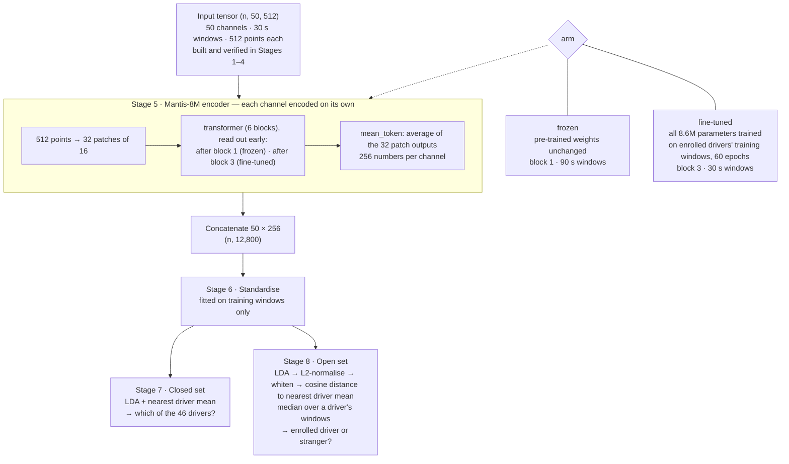

# The design space — every choice, how it was settled, what is left

Every configuration choice in the Mantis pipeline, in the order data flows
through it, with the evidence that settled it. Supersedes `design_space.md`, a
snapshot written while exp06 was running.

**Legend**

| Mark | Meaning |
|:-:|---|
| ✅ | tested; the choice was made on **inner validation** (training windows split again), never on test |
| 📊 | tested and reported on test, **not used to choose** anything |
| 🔒 | fixed by the checkpoint or the protocol, not a choice |
| ❌ | not tested — listed under future work |

## The pipeline

## The configuration this produces

| | |
|---|---|
| Cohort | 46 drivers; open set enrols 36 and holds 10 out as strangers, 5 partitions |
| Channels | 50 audited J1939 signals |
| Window | non-overlapping; **frozen 90 s, fine-tuned 30 s**; per-driver chronological 70% train / 5% gap / 25% test |
| Resampling | `np.interp` to 512 points |
| Encoder | Mantis-8M, `mean_token`. **Frozen:** read out after block 1 of 6. **Fine-tuned:** read out after block 3 of 6, all parameters trained, 60 epochs, lr 1e-4, batch 64 |
| Closed-set read-out | standardise → LDA + nearest centroid |
| Open-set scoring | standardise → LDA → L2-normalise → whiten → cosine distance to nearest driver mean; driver score = median over their windows |

| Result (test) | frozen (block 1, 90 s) | fine-tuned (block 3, 30 s) |
|---|--:|--:|
| Closed set, 46-way (chance 2.2%) | **44.9%** | **43.1% ± 0.9** |
| Closed set, 36-way | 45.7% ± 3.0 | 45.3% ± 2.6 |
| Open set, driver AUROC (chance 0.500) | **0.717 ± 0.069** | **0.689 ± 0.043** |
| Open set, window AUROC | 0.615 ± 0.029 | 0.585 ± 0.025 |

**Comparable within error bars.** Frozen's closed-set number is stable across
splits (inner 43.4%); its open-set number is not (inner 0.611), so the
fine-tuned arm's open-set number is the more reliable. At the fine-tuned arm's
own configuration (block 3, 30 s), frozen scores 27.2% / 0.632 — mostly a window
effect (`DECISIONS.md` D14).

Sources: frozen, exp06 `rescore_frozen.md`; fine-tuned, exp07 `phase_b.md`,
`phase_c_final.md`, `phase_e_46way.md`. Configurations chosen on inner
validation: exp06 `confirm_token.md`, exp07 `phase_a.md`, exp08
`layer_profile.md` and `block1_inner.md`.

---

## Stage 1 — Cohort and splits

| Axis | Tested | | Outcome | Evidence |
|---|---|:-:|---|---|
| Cohort size | 46-way closed; 36 enrolled + 10 strangers for open set | 🔒 | 46-way is the full cohort; 36/10 is forced by needing strangers | exp07 Phase E, Phase B |
| Drivers | 46 usable (G1S04 low CAN rate; G1S10/11/12 broken logger clock) | 🔒 | | `DECISIONS.md` |
| Partitions | 5 group-stratified 36/10 draws, seed 42; 2 training seeds at 46-way | ✅ | single-partition driver AUROC varies ±0.08–0.10, so 5 are needed | exp07 |
| Awareness group | G1 / G2 / G3 reported separately | 📊 | closed set level across groups (44.2 / 45.0 / 46.3%); open set best in G2 (driver AUROC 0.847) | exp08 `round3.md` |
| Split | chronological 70 / 5 / 25 within each drive | 🔒 | one drive per driver, so this is the only split available | `DECISIONS.md` C1 |
| Split direction | early → late only | ❌ | | future work |

## Stage 2 — Channels

| Axis | Tested | | Outcome | Evidence |
|---|---|:-:|---|---|
| Channel set | 50 audited | ✅ | excluded on data quality and leakage, never on accuracy | `DECISIONS.md` S1, S3 |
| Subsets | all 50, 11 actuated, 11 random ×5, top-k by η² | 📊 | 11 actuated (13.8%) lost to 11 random (18.2%); top-15 (29.2%) beat all 50 (23.2%) with LDA. Exploratory: frozen, `cls_token`, 51.2 s. All 50 kept | exp05 |
| Bursty signals (898, 518, 4191, 3544) | excluded | ❌ | silent ~92% of a drive; never revisited | future work |

## Stage 3 — Windowing

| Axis | Tested | | Outcome | Evidence |
|---|---|:-:|---|---|
| Window length | 30 / 51.2 / 90 / 120 s | ✅ | **depends on the arm**: frozen prefers long windows (90 s at block 1, 43.4%); fine-tuned prefers 30 s (47.8%, 2.8pp clear), because 30 s gives four times the training windows | exp08 `layer_profile.md`, exp07 `phase_a.md` |
| Overlap | 0% only | ❌ | would multiply training windows, which limit fine-tuning | future work |

## Stage 4 — Resampling

| Axis | Tested | | Outcome | Evidence |
|---|---|:-:|---|---|
| Target length | 512 | 🔒 | required by the checkpoint | |
| Method | `np.interp` vs bin averaging | ✅ 📊 | inner validation kept `np.interp` (Round 1); on test, bin averaging won 2 of 5 partitions at 30 s and lost on driver AUROC at every other window (Round 2). Not adopted | exp08 `round1.md`, `round2.md` |
| Effect on continuous signals (44) | 4 window lengths | ✅ | 0 channels severely distorted; median variance retained 0.992 at 30 s | `resampling_distortion.md` |
| Effect on step signals (6) | 4 window lengths | ✅ | at most 0.65% invented values, same at every window; accepted | `aggregation_validity_50ch.md`, `DECISIONS.md` S5 |
| Zero-order hold for step signals | — | ❌ | | future work (S5) |

## Stage 5 — Encoder

| Axis | Tested | | Outcome | Evidence |
|---|---|:-:|---|---|
| Checkpoint | Mantis-8M | ⚠️ | other checkpoints ranked once, early, with a nearest-centroid read-out on an 8-channel set | `DECISIONS.md` D10 |
| Read-out block | frozen: all 6 blocks, 5 partitions; fine-tuned: blocks 1, 3, 6 | ✅ | Mantis counts blocks from 0 (index 2 = block 3). **Frozen:** accuracy falls with depth at every window; block 1 beats block 3 at 4 of 4 windows → frozen reads out after block 1. **Fine-tuned:** block 1 wins 2 of 4 → stays at block 3 | exp08 `layer_profile.md`, `block1_inner.md`, `round1.md`; D14 |
| Output token, frozen | `cls` / `mean` / `combined`, 4 windows, 46-way | ✅ | `mean_token` wins at every window by 7–12pp; `combined` (twice the features) never beats it | exp06 `confirm_token.md` |
| Output token, frozen, open set | same 3 tokens × 4 windows, re-scored with the open-set scoring above | 📊 | `mean_token` best at every window (driver AUROC 0.632–0.746 against 0.543–0.599 for `cls_token`); the token matters for open set too | exp06 `rescore_frozen.md` |
| Output token, fine-tuned | `cls` / `mean` / `combined`, 30 s, 5 partitions | 📊 | `mean_token` best closed set on all 5 partitions (45.3% vs 40.2% / 40.6% LDA); open set within noise (`cls_token` 0.713 ± 0.078 vs 0.689 ± 0.043). Pre-registered: headline stays `mean_token` | exp06 `full_token.md` |
| Training mode | frozen / head-only / full / from scratch | ✅ | full 32.2% > head 27.2% > scratch 24.8% (inner validation, 36-way): pre-training helps, and fine-tuning helps further | exp04 Stage 1 |
| Fine-tuned vs frozen | headline arms | 📊 | each at its own configuration: comparable (44.9% vs 43.1%; 0.717 vs 0.689). At a matched block and window, fine-tuning adds up to +17.9pp where training windows are plentiful and loses up to 3.7pp where they are scarce | exp06 grid, exp07, exp08 `block1_inner.md` |
| Epochs | 30 / 60 / 100 / 200 | ✅ | all arms memorise by epoch ~40; 60 and 200 statistically indistinguishable; 60 pinned | exp04 Stage 1 |
| Learning rate | 1e-4 only | ❌ | | future work |
| Batch size | 64 only | ❌ | | future work |
| Multivariate handling | each channel encoded alone, then concatenated | ❌ | channel adapters untested: `MantisTrainer.transform()` ignores them | future work; `DECISIONS.md` B3 |

## Stage 6 — Representation post-processing

| Axis | Tested | | Outcome | Evidence |
|---|---|:-:|---|---|
| Per-channel mean/std appended | with / without | 📊 | no gain: LDA 28.7% → 29.0% frozen, 33.2% → 33.2% fine-tuned | exp04 `results.md` |
| Scaling | `StandardScaler`, fitted on train | 🔒 | | |
| Channel attention | attention pooling, self-attention | 📊 | 11.3% and 10.9%, against 28.7% for LDA on the same embeddings | exp04 `attention_readout.md` |
| Open-set projection | PCA 5–100, LDA | ✅ | LDA (median driver AUROC 0.667 vs 0.574 for the best PCA) | exp07 `phase_c_sweep.md` |
| Open-set transform | none, L2, whiten, both orders | ✅ | L2-normalise then whiten | exp07 `phase_c_sweep.md` |

## Stage 7 — Closed-set read-out

| Axis | Tested | | Outcome | Evidence |
|---|---|:-:|---|---|
| Read-out | nearest centroid, linear probe, LDA + centroid, random forest, attention | 📊 | LDA + centroid best or joint-best in every arm. On identical frozen embeddings (51.2 s, 46-way) nearest centroid gives 10.6%, LDA 23.2% | exp03 `embedding_analysis.md`, exp05 |
| Logistic regression `C` | default only | ❌ | | future work |
| Forest size | 500 trees only | ❌ | | future work |

## Stage 8 — Open set

| Axis | Tested | | Outcome | Evidence |
|---|---|:-:|---|---|
| Scoring configuration | 1,300: 10 projections × 5 transforms × 4 prototypes × 13 rules | ✅ | chosen by **median** across configurations, then pre-registered. The single best inner cell (0.806) fell to 0.549 on test; the pre-registered one held at 0.689 | exp07 `phase_c_sweep.md`, `phase_c_final.md` |
| Outlier detectors | nearest neighbour, local outlier factor, isolation forest, one-class SVM | ✅ | all below 0.50 median driver AUROC | exp07 `phase_c_sweep.md` |
| Prototype | mean, median, k-means (2–3 per driver) | ✅ | one mean per driver; k-means did not help | exp07 `phase_c_sweep.md` |
| Pooling a driver's windows | median, mean, trimmed mean, 90th percentile, max | 📊 | median / mean / trimmed 0.689–0.709; extremes worse (0.618–0.629) | exp07 `phase_d.md` |
| Operating points | AUROC, AUPR, EER, strangers accepted at 95% enrolled | 📊 | driver EER 0.341; 82% of strangers still accepted when 95% of enrolled drivers are | exp08 `round3.md` |
| Enrolment size | 25 / 50 / 75 / 100% of training windows | 📊 | frozen 18.4% → 30.5% top-1 as enrolment grows | exp08 `round3.md` |
| Energy score | — | ❌ | needs logits; weights were not saved | future work |
| Verification (claimed identity) | — | ❌ | | future work |
| Number of strangers | 10 only | ❌ | | future work |

---

## Future work

| Axis | Why it matters |
|---|---|
| **Parameter-efficient fine-tuning (LoRA, BitFit, last-N blocks)** | full fine-tuning helps when training windows are plentiful (+17.9pp at 30 s) and hurts when they are scarce (−3.6 to −3.7pp at 90–120 s; `block1_inner.md`). Updating few parameters targets exactly that regime. Mantis does not ship it |
| Step-channel ablation and zero-order hold | proves the step channels' pre-processing does not drive the results (`DECISIONS.md` S5) |
| Overlapping windows | more training windows, the limit on fine-tuning |
| Split direction (train late, test early) | is identity stable in both directions within a drive |
| Channel adapter | the encoder's own route to cross-channel information |
| Learning rate, batch size, `C`, forest size | never tuned |
| Energy score, claimed-identity verification | standard open-set and biometric framings not yet computed |
| G1S10/11/12 | the clock fault is in `canloggerTime` only; recoverable to 49 drivers |
| Bursty signals | excluded on a first pass, never revisited |
